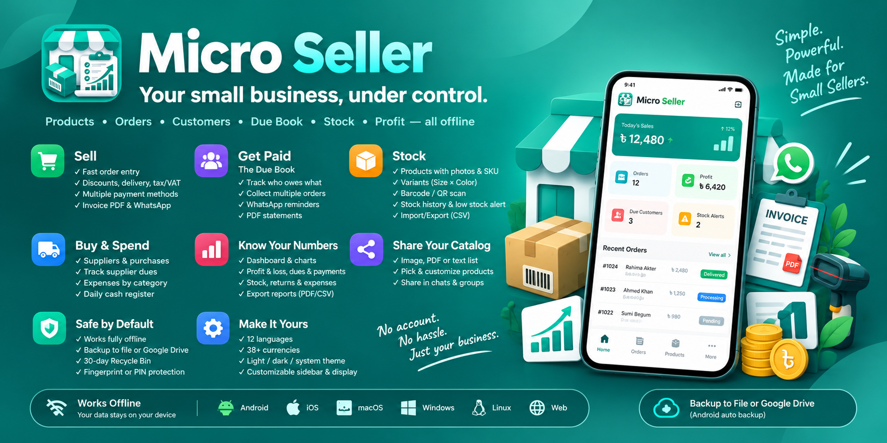

<p align="center">
  <a href="https://play.google.com/store/apps/details?id=com.blackshadowsoftware.micro_seller"></a>
</p>
<p align="center">
  <a href="https://github.com/RemonAhammad/micro_seller/releases/latest"></a>
</p>
<p align="center">
  <a href="https://github.com/RemonAhammad/micro_seller/releases"></a>
  <a href="https://github.com/RemonAhammad/micro_seller/actions/workflows/ci.yml"></a>
  <a href="LICENSE"></a>
</p>

# Micro Seller

**Micro Seller** is an inventory, order and credit book for small sellers: a corner shop, a home business, or a seller who takes orders on Facebook and WhatsApp. It keeps your products, stock, orders, customers, dues, suppliers and expenses in one place. It shows what you really earn, after discounts, returns and costs.

- **Works fully offline.** No account, no sign-up. Your data stays on your phone.
- **Safe.** Back up to a file or to your own Google Drive, restore with automatic rollback, and undo deletes for 30 days.
- **Speaks your language.** 12 languages, 38 currencies, light and dark themes.
- **Open source.** Free software under the [GPL-3.0](LICENSE) license.

## Contents

- [Download](#download)
- [Features](#features)
- [Privacy](#privacy)
- [Platforms](#platforms)
- [For developers](#for-developers)
- [License](#license)

## Download

### Google Play (recommended)

Install Micro Seller from [Google Play](https://play.google.com/store/apps/details?id=com.blackshadowsoftware.micro_seller). Updates then arrive through the Play Store.

<a href="https://play.google.com/store/apps/details?id=com.blackshadowsoftware.micro_seller"></a>

### APK from GitHub

For phones without Google Play. GitHub Actions builds and signs each release from this repo.

1. Open the [latest release](https://github.com/RemonAhammad/micro_seller/releases/latest) and find **Assets**.
2. Tap the APK for your phone:

   | File | For |
   | --- | --- |
   | `micro-seller-vX.Y.Z-universal.apk` | Every Android phone. The largest file. |
   | `micro-seller-vX.Y.Z-arm64-v8a.apk` | Most phones. Smaller. |
   | `micro-seller-vX.Y.Z-armeabi-v7a.apk` | Older 32-bit phones |
   | `micro-seller-vX.Y.Z-x86_64.apk` | Emulators and Chromebooks |

3. Open the downloaded file. If Android asks, allow your browser to install apps.

- **Updates:** download the next release and keep the same file type. Android won't switch from a per-CPU APK (arm64-v8a, armeabi-v7a) to the universal one.
- **Already installed from Google Play?** A GitHub APK can't update a Play install, or the other way round, because Google Play signs its copy with its own key. To switch, back up first (Settings → Backup), uninstall, then install.

## Features

### Sell

- **Fast order entry.**
  - Pick a customer, or add a new one without leaving the order.
  - Add several products in one go, with live stock. You can't sell more than you have.
- **Prices that add up:** discount, delivery fee, and a tax/VAT rate per order, with a live total.
- **Payment methods:** cash, card, mobile money (bKash, Nagad), bank or other.
- **Partial payments**, with the balance due tracked on the order.
- **Order status:** pending → confirmed → shipped → completed, or cancelled.
  - Stock goes out when an order is confirmed and comes back if it's rolled back, cancelled or deleted.
  - Long-press an order to change its status.
- **Invoices:** share, download or print a PDF invoice, or send it as WhatsApp text. Bengali, Arabic, Thai and other scripts render correctly.
- **Delivery tracking:** a delivery address, an expected date and "mark as delivered".
- **Recurring orders:** repeat an order every N days automatically.
- **Returns and refunds:**
  - Return some or all of an order's items, with a reason, and restock them on approval.
  - A refund is capped at what the customer paid.
  - A returned item is valued at what the customer actually paid for it, including its share of the discount.

### Due Book: get paid

The Due Book shows who owes you money and since when.

- **Ages:** each customer's due is bucketed under 30, 30–60 or 60+ days, with an alert when someone owes for 60+ days.
- **Sort and filter:** by amount, age, last payment, unpaid orders or customer tag.
- **Collect** one payment across a customer's unpaid orders, oldest first. It can add cash to the day's cash register.
- **Remind** a customer on WhatsApp in your language.
- **Statements:** share a customer statement PDF with a running balance.
- **History:** a full payment history for every customer and order.

### Products and stock

- **Products:** photos, SKU, categories, cost and selling price, profit margin, and a low-stock threshold.
- **Variants:** up to 3 attributes (e.g. Size × Color). Each combination has its own stock, price and SKU.
- **Barcodes:** scan a QR code or barcode to find a product, or to add it as a new one.
- **Stock adjustments:** restock, adjustment or damage, with a reason, plus the full movement history.
- **Low-stock alerts** and unpaid-order reminders as notifications.
- **Spreadsheets:** import products from CSV, and export products, orders and expenses to CSV.

### Share your catalog

- Pick products and send them as an image, a PDF or a plain-text price list. Variant prices are included.
- Your shop name and phone number appear at the top, ready for chats and groups.

### Buy and spend

- **Suppliers and purchases:**
  - Record what you buy: stock goes up and cost prices update.
  - Track what you owe each supplier, and record payments.
- **Expenses** by category: logistics, packaging, marketing, supplies, other.
- **Daily cash register:** open the day with your cash, record cash in and out, and close it to see whether you're over or short.

### Know your numbers

- **Dashboard:**
  - Sales, orders and profit for the range you pick (today, this week, this month or custom), plus money customers owe you, dues collected this month, and low stock.
  - Charts: weekly sales, order status, and revenue vs expenses.
- **Reports** for any date range, in four tabs:
  - **Profit & Sales:** a profit and loss statement (sales → discounts → returns → cost of goods → gross profit → delivery → expenses → net profit), plus top products, categories and customers.
  - **Dues & Payments:** money received by method, dues collected, credit given and refunds.
  - **Stock & Returns:** stock value, best sellers, items that didn't sell, and return reasons.
  - **Purchases & Expenses:** purchases, supplier dues, expenses by category and the cash register.
- **Export** any report as PDF or CSV.

### Safe by default

- **Offline-first:** everything is stored on the device in a local database.
- **Backups:**
  - Export to a file, or back up to your own Google Drive.
  - Turn on auto backup for a daily Drive backup (Android).
  - A failed restore rolls back to what you had.
- **Recycle Bin:** undo a delete right away, or restore deleted products, customers, expenses and categories within 30 days.
- **Fingerprint or PIN** protection for destructive actions, such as clearing all data.

### Make it yours

- **12 languages:** English, বাংলা (Bengali), العربية (Arabic), Español, Français, Português, Türkçe, Bahasa Indonesia, ไทย (Thai), Tiếng Việt, اردو (Urdu) and Bahasa Melayu.
- **38 currencies**, with your shop's name, phone number and default tax rate.
- **Themes:** light, dark, or follow the phone.
- **Display size and text size:** for small or large screens.
- **Sidebar:** reorder its tabs, hide the ones you don't use, and put it on the left or the right.

## Privacy

Micro Seller has no account and no server. Your business data stays on your device. If you turn on Google Drive backup, the backups go to a hidden app folder in **your own** Google Drive (the `drive.appdata` scope). The app can't see your other Drive files, and nobody else can see the backups.

## Platforms

| Platform | Status |
| --- | --- |
| Android | On [Google Play](https://play.google.com/store/apps/details?id=com.blackshadowsoftware.micro_seller), and APKs on [GitHub Releases](https://github.com/RemonAhammad/micro_seller/releases) |
| iOS, macOS, Windows, Linux, Web | Built from the same code; build them from source (see below) |

## For developers

### Tech stack

| Area | Built with |
| --- | --- |
| App | [Flutter](https://flutter.dev) (Dart ≥ 3.12) |
| State | Riverpod 3 with code generation |
| Database | Isar (the [isar_community](https://pub.dev/packages/isar_community) fork), with heavy queries on worker isolates |
| Navigation | go_router with a 14-tab sidebar shell |
| Models | Freezed and json_serializable |
| PDF | Widgets rendered to images, then `pdf` and `printing`, so every script shapes correctly |
| Charts | fl_chart |
| Backup | Google Sign-In 7 and the Google Drive API (app-data folder) |
| Background work | WorkManager (daily auto backup on Android) |
| Security | local_auth (fingerprint) and a salted SHA-256 PIN |

### Run it locally

You need Flutter. CI uses the version pinned in [`.github/actions/setup-flutter/action.yml`](.github/actions/setup-flutter/action.yml).

```bash
git clone https://github.com/RemonAhammad/micro_seller.git
cd micro_seller
cp .env.example .env          # Google OAuth client IDs, only needed for Drive backup
flutter pub get
flutter run
```

Generated code (`*.g.dart`, `*.freezed.dart`) is committed. After you change a model or a provider, regenerate it:

```bash
dart run build_runner build --delete-conflicting-outputs
```

### Checks

```bash
flutter analyze
flutter test                                    # includes tests on a real Isar database, offline
bash .claude/skills/l10n/scripts/l10n_parity.sh # every string in all 12 languages
```

GitHub Actions runs the same checks on every push and pull request ([`ci.yml`](.github/workflows/ci.yml)). The tests cover the money flows (profit, returns and refunds, dues), worker isolates, backups, paging, and every screen's layout from small phones up to 150% text.

### Project structure

```text
lib/
├── core/        # constants, localization (12 languages), router, theme, utils
├── data/        # Isar models, repositories, services (backup, PDF, reports, dues, notifications)
├── features/    # one folder per area: orders, products, customers (+ Due Book), inventory,
│                # suppliers, expenses, cash register, reports, dashboard, settings, …
└── shared/      # shared widgets
```

### Releases

From your Mac, `./release.sh` cuts a release:

1. It syncs with GitHub and picks the next version.
2. It runs the checks.
3. It commits, tags and pushes.
4. GitHub Actions builds the signed APKs and the Play Store bundle and drafts the GitHub release, and the script follows the build.

See [RELEASE.md](RELEASE.md) for the Play Store guide and the CI/CD setup.

## License

Copyright © 2026 Black Shadow Software

Micro Seller is free software. You can redistribute it and/or modify it under the terms of the [GNU General Public License v3.0](LICENSE), as published by the Free Software Foundation, either version 3 of the License or (at your option) any later version.

It is distributed in the hope that it will be useful, but **without any warranty**, without even the implied warranty of merchantability or fitness for a particular purpose. See the [license](LICENSE) for details.

The license covers the source code. The Micro Seller name, logo and banner aren't licensed under it.
